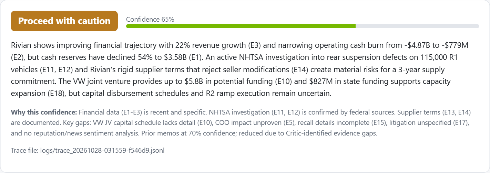
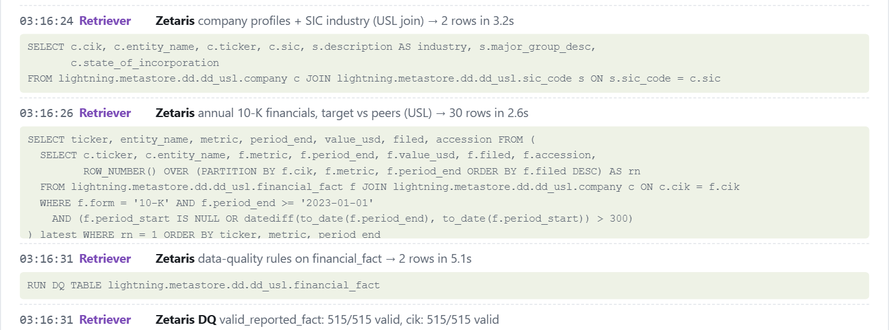
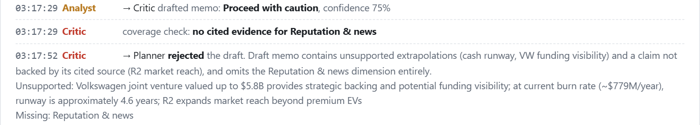
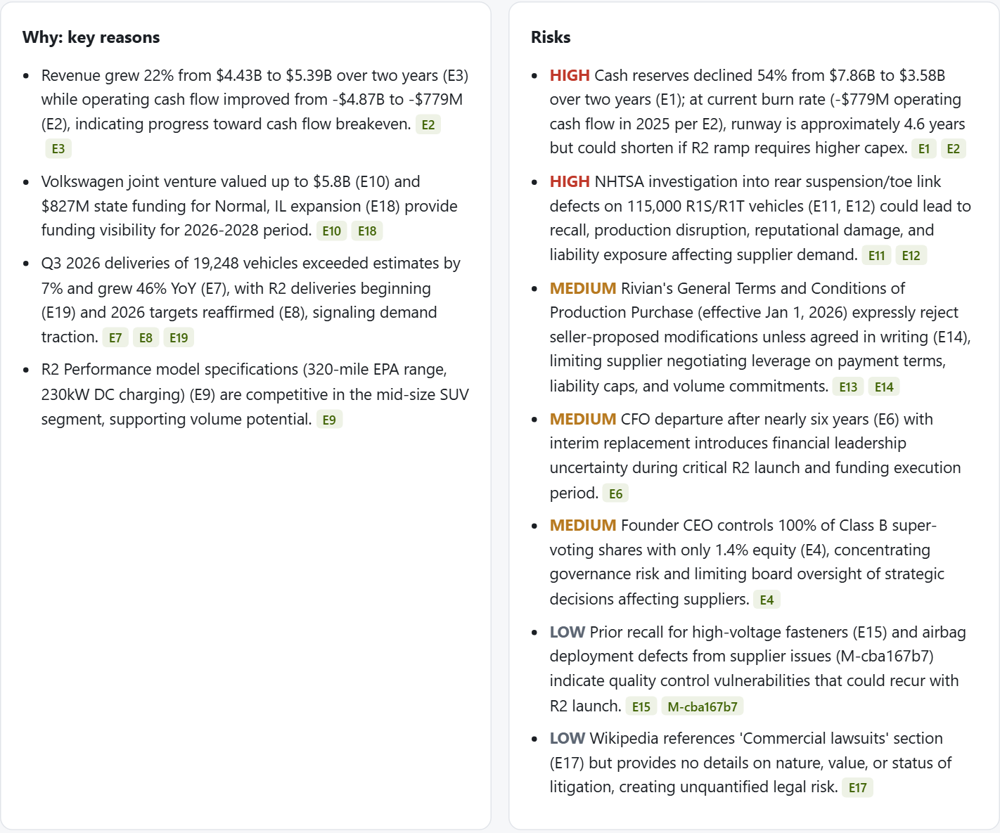
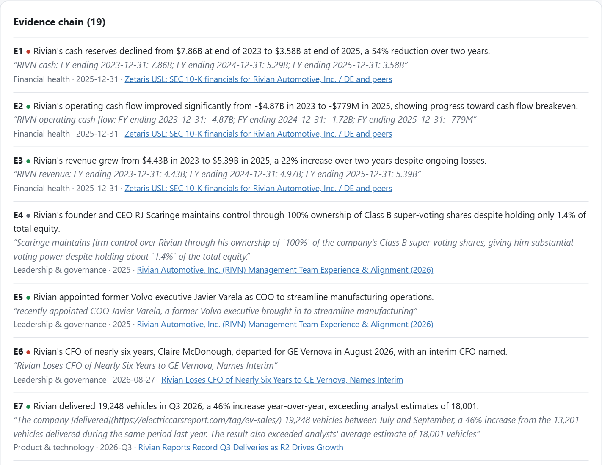
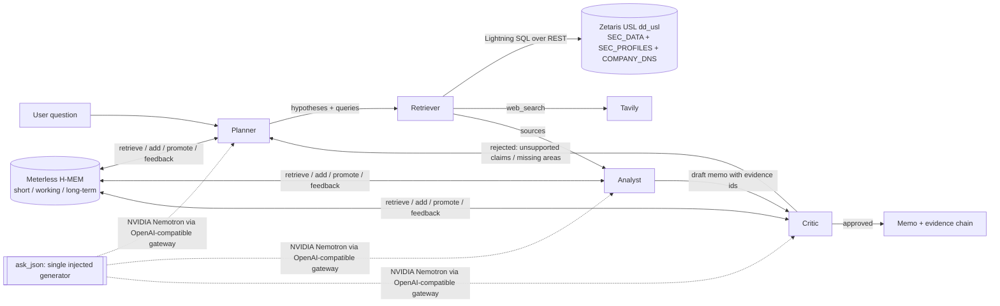

# Because: the due-diligence agent that can explain why

**Open Agent Hackathon 2026, Track 02: The Agent That Can Explain Why. Team Because.AI.**

[Pitch deck](https://docs.google.com/presentation/d/1bBBqqKW8Pyl7h2QZr2PVqt9UCu5oShLLEDbtAvs3b48)

Before a supplier signs a multi-year contract, or a fund invests, someone has to answer: *is this company safe to depend on, and why?* Today an analyst spends days reading filings, news and court records, then writes a memo a risk committee can challenge line by line.

**Because** is a team of four agents that does the first pass in minutes, and **every sentence in its memo cites the evidence behind it**: an SEC 10-K figure from a Zetaris semantic layer, or a quoted line from a web page. A Critic agent audits the draft and sends it back when a claim is unsupported or a risk area has no evidence. What the team learns is kept in Meterless H-MEM memory, so the next investigation of the same company starts from it.

**Users:** procurement and supplier-risk teams, credit analysts, M&A and VC associates.

## Screenshots

The verdict, with the confidence and why it is not higher:



The Retriever queries the Zetaris semantic layer; the SQL, row counts and data-quality result are in the trace:



The Critic rejects a draft and sends it back to the Planner:



Reasons and risks, each citing evidence ids:



The evidence chain: every claim with its exact quote and source link (E1–E3 come from SEC filings through Zetaris):



## What a run looks like

Question: *"Should a mid-size EV parts supplier sign a 3-year supply contract with Rivian? What are the key risks?"*

Recorded run (`samples/rivian.jsonl`, the third investigation of Rivian; replay it with `--sample`):

```
H-MEM                hydrate: 31 long-term memories from earlier runs; 5 injected into the Planner
Retriever            Zetaris: company profiles + SIC industry, annual 10-K financials vs peers, DQ 515/515
Retriever -> Analyst 18 sources (1 Zetaris + 17 web) -> 14 quoted evidence items
Analyst -> Critic    draft "Proceed with caution", confidence 75%
Critic -> Planner    REJECTED: unsupported extrapolations (cash runway, VW funding visibility), a claim
                     its cited source does not support (R2 market reach), no Reputation & news evidence
Planner -> Retriever round 2: follow-up queries only for what the Critic asked
Analyst -> Critic    19 evidence items; revised draft, confidence 70%
Critic               REJECTED again: unsupported claims on VW JV progress, COO impact, litigation
Analyst              final memo drops what the Critic could not accept: confidence 65%,
                     gaps listed explicitly (reputation sentiment, VW tranche schedule, full supplier terms)
H-MEM                18 cited evidence items promoted to long-term memory for the next run
```

Each rejection lowered the confidence instead of hiding the problem: that is the "explain why" behaviour.

The memo then shows verdict, confidence and why, reasons, risks (with severity), contradictions between sources, gaps and next steps, each linked to numbered evidence and its source URL. Example finding from Zetaris: *Rivian's cash fell from $7.86B (FY2023) to $3.58B (FY2025), but operating cash burn narrowed from -$4.87B to -$779M, so cash covers about 4.6 years of 2025 burn; peer Lucid's covers about 0.3 years.*

## Architecture



| Agent | Role | Talks to |
|---|---|---|
| **Planner** | Turns the question into hypotheses and search queries across 6 risk dimensions; on a rejection, plans only the follow-up the Critic asked for. Reads procedural memory ("web gave weak evidence on X last time"). | Retriever |
| **Retriever** | Queries the Zetaris USL for audited financials and data-quality results, runs web searches, fetches pages. | Analyst |
| **Analyst** | Extracts claims with exact quotes from each source, then writes the memo citing evidence ids. Reads conclusions from earlier runs in H-MEM and notes if new evidence changes them. | Critic |
| **Critic** | Checks every cited claim against its evidence, runs a coverage check (each risk dimension needs cited evidence), and approves or sends the work back (max 2 rounds). Its verdicts become memory feedback. | Planner or User |

Every message between agents is written to `logs/trace_<run_id>.jsonl` and streamed to the UI.

## Sponsor technology, and where it is in the code

### Meterless: H-MEM engine ([`hmem.py`](hmem.py))

| H-MEM service | What we use it for | Code |
|---|---|---|
| **MemoryStoreService** | Three-tier memory (short-term / working / long-term) shared by all agents, with provenance (`source`, `agentId`, `runId`, `derivedFrom`). Each evidence item is mined into short-term memory; cited evidence is promoted to long-term; long-term persists in `memory/long_term.jsonl` and is hydrated at the start of the next run. | `HMem.add`, `promote`, `_hydrate` |
| **MemoryRetrievalService** | Task-focused retrieval (embedding + keyword + entity + tag scoring, layer and confidence weighting) injected into the Planner and Analyst prompts. | `HMem.retrieve`, `as_prompt_block` |
| **TrustLedgerService** | Append-only audit of every create/read/promote/feedback, plus a retrieval trace. The Critic's approval adjusts memory confidence (`helpful` / `wrong`). | `HMem._audit`, `feedback`; `logs/hmem_ledger_*.jsonl`, `logs/hmem_retrieval_*.jsonl` |

**Injected generator:** every model call from every agent goes through one function, `ask_json` in [`agent.py`](agent.py), configured only by `LLM_BASE_URL` / `LLM_MODEL` / `LLM_API_KEY`. Pointing `LLM_BASE_URL` at a Meterless gateway (or any OpenAI-compatible endpoint) changes the generator for the whole system without touching agent code.

**Sample mode:** with no `LLM_API_KEY`, or with `--sample` / the UI checkbox / `SAMPLE_MODE=1`, the app replays a recorded real run from [`samples/`](samples/) (trace events and the final memo), so it runs with no keys at all.

**Cross-run memory:** run the same company twice. The second run's trace shows `H-MEM hydrate long_term_memories: N` and `retrieve ... from_previous_runs: N`, and the Planner targets gaps the Critic flagged last time.

### Zetaris: semantic layer for audited financials ([`zetaris_setup.py`](zetaris_setup.py), [`zetaris_client.py`](zetaris_client.py))

| Requirement | Where |
|---|---|
| 3 data sources (REST) | `SEC_DATA` (EDGAR XBRL facts: revenue, net income, cash, operating cash flow, long-term debt), `SEC_PROFILES` (EDGAR submissions: name, ticker, SIC, state), `COMPANY_DNS` (SIC hierarchy, 1,005 codes) |
| 2–3 queries per source | [`zetaris_sql/results.md`](zetaris_sql/results.md), produced by `python zetaris_queries.py` |
| 1 USL with DDL | `lightning.metastore.dd.dd_usl`: `sic_code` ← `company` ← `financial_fact` (PK + FK), DDL in [`zetaris_sql/02_usl_create.sql`](zetaris_sql/02_usl_create.sql) |
| 2–3 queries proving the USL works | company + industry join, peer comparison, cash-runway proxy (in `results.md`) |
| 1 DQ rule | `REGISTER DQ valid_reported_fact` on `financial_fact`; `RUN DQ` returns 515/515 valid, plus auto FK/PK rules |
| 3 documents | [time saved vs hand-coding](docs/zetaris/01-usl-time-saved.md), [how the USL helps our work](docs/zetaris/02-usl-in-our-work.md), [PM improvement proposals](docs/zetaris/03-usl-product-feedback.md) |
| Used by the agent | `zetaris_query` / `zetaris_financials` in [`agent.py`](agent.py); trace events `tool_call tool=zetaris` with the SQL, row count and time |

### NVIDIA Nemotron

Reasoning model for all four agents: `nvidia/nemotron-3-ultra-550b-a55b` (served through an OpenAI-compatible gateway; set in `.env`).

## Run it

```bash
python -m venv .venv
.venv/Scripts/python -m pip install -r requirements.txt        # Windows; use .venv/bin/python on macOS/Linux
cp .env.example .env                                          # fill in keys, or skip for sample mode

# Sample mode: no keys, replays a recorded run
python run.py --input input_examples/example_1.json --sample

# Live run (CLI)
python run.py --input input_examples/example_1.json

# Web UI + API
python -m uvicorn main:app          # http://localhost:8000
curl -X POST localhost:8000/run -H "Content-Type: application/json" -d @input_examples/example_1.json
```

`POST /run` returns the memo, critic review, evidence and sources as JSON; `POST /api/investigate` streams trace events (SSE) for the UI. Both accept `"sample": true`.

### Zetaris (optional for the live run; the agent skips it if it is not reachable)

1. Get the local platform from Zetaris Cloud (Run locally), `docker compose up -d`, `./verify.sh`.
2. In `.env`: `ZETARIS_USERNAME`, `ZETARIS_PASSWORD`, and `ZETARIS_USER_AGENT="app_name you@example.com"` (SEC requires a contact).
3. `python zetaris_setup.py` creates the 3 sources, the USL and the DQ rule (37 statements, about 40 s). `python zetaris_queries.py` runs the proof queries.

## Files

| Path | What |
|---|---|
| `agent.py` | Agents, orchestration with the Critic feedback loop, tools (Zetaris, web), sample replay |
| `hmem.py` | Meterless H-MEM: MemoryStore, MemoryRetrieval, TrustLedger |
| `zetaris_client.py`, `zetaris_setup.py`, `zetaris_queries.py`, `zetaris_sql/` | Zetaris client, onboarding, proof queries and their results |
| `main.py`, `static/index.html` | FastAPI + live trace UI |
| `run.py`, `input_examples/` | CLI and example inputs |
| `samples/` | Recorded real runs for sample mode |
| `metadata.json` | Track, engines and sponsor tech used |
